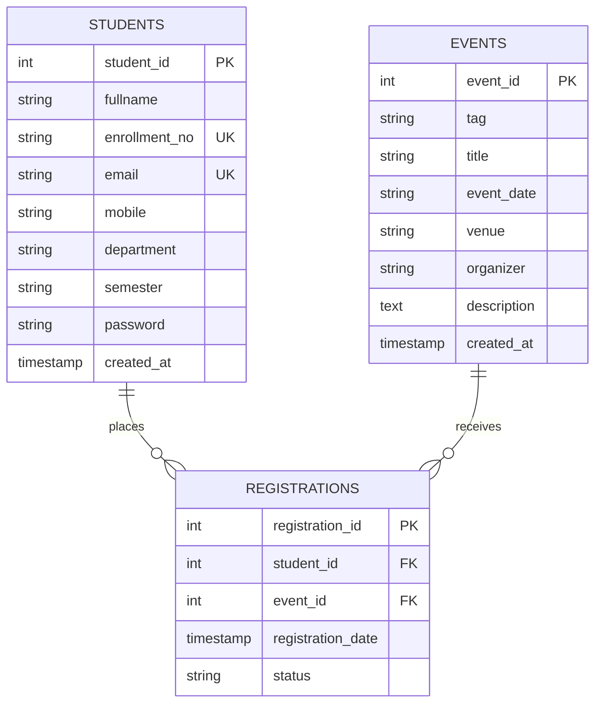

# Practical 8: MySQL Schema Design & ER Model for StudentHub

## Problem Definition
> **Design the database for StudentHub with students, events and registrations. Create PHP database connection using MYSQL statements.**

---

## 1. Entity-Relationship (ER) Model Overview

The **StudentHub** system models the interactions between students and campus events through registrations:

1. **`students` Entity**: Represents university students who can create an account and register for events.
2. **`events` Entity**: Represents university events, workshops, hackathons, and cultural fests hosted across campus.
3. **`registrations` Entity (Associative Table)**: Resolves the **Many-to-Many (M:N)** relationship between students and events. One student can register for multiple events, and one event can have multiple student registrations.

---

## 2. ER Diagram (Mermaid)

---

## 3. Entity Details & Schema Definitions

### Table 1: `students`
| Attribute | Data Type | Constraints | Description |
|---|---|---|---|
| `student_id` | `INT` | `PRIMARY KEY, AUTO_INCREMENT` | Unique identifier for each student |
| `fullname` | `VARCHAR(100)` | `NOT NULL` | Student's full name |
| `enrollment_no`| `VARCHAR(50)` | `NOT NULL, UNIQUE` | University enrollment number (e.g. 23CE001) |
| `email` | `VARCHAR(100)` | `NOT NULL, UNIQUE` | University email address |
| `mobile` | `VARCHAR(15)` | `NOT NULL` | Contact number (10 digits) |
| `department` | `VARCHAR(50)` | `NOT NULL` | Academic branch/department |
| `semester` | `VARCHAR(20)` | `NOT NULL` | Current semester |
| `password` | `VARCHAR(255)` | `NOT NULL` | Hashed password |
| `created_at` | `TIMESTAMP` | `DEFAULT CURRENT_TIMESTAMP` | Account creation timestamp |

### Table 2: `events`
| Attribute | Data Type | Constraints | Description |
|---|---|---|---|
| `event_id` | `INT` | `PRIMARY KEY, AUTO_INCREMENT` | Unique identifier for each event |
| `tag` | `VARCHAR(50)` | `NOT NULL` | Category tag (Technical Fest, Cultural, Workshop, etc.) |
| `title` | `VARCHAR(150)` | `NOT NULL` | Name of the event |
| `event_date` | `VARCHAR(50)` | `NOT NULL` | Date or date range of the event |
| `venue` | `VARCHAR(100)` | `NOT NULL` | Campus venue/hall |
| `organizer` | `VARCHAR(100)` | `NOT NULL` | Organizing department or committee |
| `description` | `TEXT` | `NOT NULL` | Detailed description of event activities |
| `created_at` | `TIMESTAMP` | `DEFAULT CURRENT_TIMESTAMP` | Event record creation timestamp |

### Table 3: `registrations` (Junction Table)
| Attribute | Data Type | Constraints | Description |
|---|---|---|---|
| `registration_id`| `INT` | `PRIMARY KEY, AUTO_INCREMENT` | Unique identifier for registration record |
| `student_id` | `INT` | `NOT NULL, FOREIGN KEY -> students(student_id)` | References the registered student |
| `event_id` | `INT` | `NOT NULL, FOREIGN KEY -> events(event_id)` | References the event |
| `registration_date`| `TIMESTAMP` | `DEFAULT CURRENT_TIMESTAMP` | Date and time when student registered |
| `status` | `VARCHAR(20)` | `DEFAULT 'Confirmed'` | Registration status (Confirmed, Pending, etc.) |
| `(student_id, event_id)`| `UNIQUE KEY` | Composite unique constraint | Prevents duplicate registration for the same event |

---

## 4. Cardinality & Relationship Analysis

- **Students to Registrations**: $1 : N$ (One student can have multiple event registrations)
- **Events to Registrations**: $1 : N$ (One event can have multiple student registrations)
- **Students to Events**: $M : N$ (Many students can register for Many events)
- **Referential Integrity**:
  - `ON DELETE CASCADE`: If a student or event record is deleted, related registration records are automatically cleaned up.
  - `ON UPDATE CASCADE`: Cascades key updates automatically.
